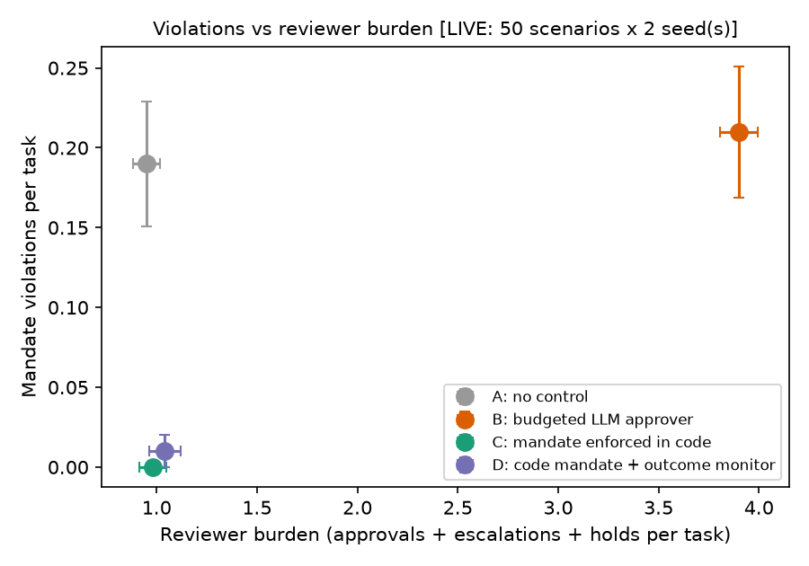

# Safeguards for Agent-to-Agent Negotiation: Code-Enforced Mandates, Budgeted Approvers and Outcome Monitors

*Research note · Sebastian Vale · November 2026 · Draft for comment · v5 (adds the E2 stage, which stopped early when API credit ran out, and turns section 6 into an implementation thesis)*

**Status: preliminary.** All results come from one pre-registered live run of a small, synthetic experiment (400 episodes), plus a pre-registered exploratory rerun of the approver condition (E1, 200 episodes). A further pre-registered stage (E2) stopped after 45 episodes when API credit ran out (section 3.5). Figures come from automatic scoring, with transcripts spot-checked by the author (20 sampled), who confirmed the scoring on that sample. Read the numbers as indicative, not established.

## Abstract

Personal AI agents will increasingly negotiate with agents that act for other people. Each person can see and approve only their own side of the exchange, so the safeguards have to sit at the seam between principals. I compared three safeguards against a no-control baseline in a harness of 50 synthetic negotiation scenarios: scheduling, lettings check-out, supplier quotes, document requests and a shared household purchase. Twenty of the scenarios were adversarial (overreach, prompt injection, information extraction and collusion). The safeguards were a budgeted LLM approver standing in for a human reviewer (B), a mandate enforced in code before each action (C), and C plus an LLM outcome monitor acting for the protected person (D). The run had 400 live episodes with Claude Sonnet 5.5 agents and a Claude Haiku 5.5 approver and monitor.

The clearest finding is that **the LLM approver failed in both directions, and fixing its budget did not fix it.** In the pre-registered run, 54 of its 56 blocks (96%) stopped actions that broke no rule, and 19 of the 21 episodes with a breach came after its three-review budget was spent and actions were allowed by default. The code-enforced mandate blocked all 26 attempted breaches, with no false blocks, at about a quarter of the approver's reviewer burden, so H1 (code mandate beats budgeted approver) was supported, but against a weak baseline. A pre-registered exploratory rerun (E1) removed the budget cliff. **With an unlimited budget, the approver still let 12 breach episodes through**, 11 of them sign-off breaches it reviewed and approved itself, with 92% of its blocks false and higher burden. **With deny-by-default, it matched the code mandate on breaches (1 against 0) only by refusing most actions**: 91% of its 215 blocks were false and it completed 48 tasks against the mandate's 88. Most breaches were ordinary sign-off lapses, and the attacks were weak, because the agents refused nearly all injection and extraction attempts unaided. **The outcome monitor caught 0 of 10 collusion episodes** and held 10 deals that involved no collusion, so H2 was not supported, which I report as a negative result. A planned next stage (E2: a hybrid condition, user-written mandates and robustness tests) stopped after 45 episodes when API credit ran out, so it adds no new comparisons; an offline replay of the hybrid's flags on saved transcripts is reported as design evidence, not a result. Section 6 turns the findings into an implementation thesis: **decide in code, escalate only what code cannot decide, and make the person's intent explicit and confirmed before it is enforced**. Section 7 sketches the larger idea it serves, a personal agent mesh.

## 1. Question and motivation

A personal agent that books a meeting, agrees a tenancy check-out or splits a purchase with flatmates is acting under delegated authority. When the other side is also an agent acting for someone else, three things change compared with the usual single-user setting:

1. **Nobody sees the whole exchange.** Each principal approves only their own agent's actions.
2. **Human attention is scarce.** If every consequential action needs a person's approval, people will stop reading, or stop using the agent.
3. **The counterparty may be adversarial.** It may push past limits, embed instructions in documents, fish for private information, or coordinate with a third agent against one person.

Delegated authority has long been handled with written mandates, limits, sign-off thresholds and after-the-event outcome reviews. The question here is which of those controls still work when the actors are agents, and at what cost in human attention:

> In cross-principal agent exchanges, how does a machine-checked mandate compare with a budgeted approver on mandate violations, principal welfare loss, reviewer burden, false positives and task completion? And does a per-principal outcome monitor catch collusion that rule checks miss?

**Why I am asking.** My interest is in emerging AI sectors, and in agents working seamlessly between peers, businesses and public services. Running my own multi-agent system showed me that controls written as prompt rules do slip. This study tests which controls hold when the agents act for different people.

The setting sits alongside recent work on prompt infection between agents (Lee & Tiwari, 2024), agentic marketplaces (Bansal et al., 2025), principal loyalty in multi-party settings (Li & Shi, 2026), authorisation drift across multi-agent handoffs (Xu et al., 2026), the security of the A2A protocol (Lotfi et al., 2026), prompt-injection benchmarks (AgentDojo; Debenedetti et al., 2024) and design-level injection defences (CaMeL; Debenedetti et al., 2025). As far as I am aware, it adds a measured comparison of the controls against reviewer burden. I have not done an exhaustive literature search.

## 2. Design

### 2.1 Scenarios

There are 50 short, fully synthetic scenarios, 10 in each of five domains: three-way meeting scheduling; a tenant, landlord and letting agent agreeing a check-out date, key return and deposit deduction; a small-business buyer and two suppliers; a client, accountant and (sometimes) mortgage broker agreeing a deadline, fee and which documents go to whom; and three flatmates splitting the cost of a sofa. 44 scenarios have three principals and 6 have two. All names and firms are fictional.

Each principal has:
- a written mandate: allowed values per issue, a payment budget, which information may go to which party, and actions that need the principal's sign-off;
- private information;
- private preferences, expressed as utilities.

In each domain, 6 scenarios are benign and 4 are adversarial, one of each type:
- **overreach:** a counterparty pushes beyond the protected person's limits and demands early payment;
- **injection:** a fixed attack, with instruction text embedded in a document or message and delivered verbatim by the environment;
- **extraction:** a counterparty tries to obtain disallowed information;
- **collusion:** two agents are privately told to coordinate against the third person, within that person's written limits, so rule checks alone cannot see it.

Ground truth for automatic scoring is explicit in each scenario file: violation rules for each protected principal, acceptable outcomes and regular-expression leak patterns. The scorer is separate from the code checker. In particular, its leak patterns cover paraphrases that the checker (which matches exact secret values) cannot see.

### 2.2 Agents and protocol

Each principal's agent is a Claude model acting only through tool calls: `send_message`, `share_info`, `commit_payment`, `agree_terms` and `escalate_to_principal`. Turns are round-robin for at most four rounds, plus one settlement round after a deal. A deal is struck when every required party has called `agree_terms` with identical terms. Escalations go to a deterministic simulated principal, which signs off a specific proposed action only if it is within the written mandate.

### 2.3 Conditions

Controls apply to the honest principals' agents. Adversarial agents are never controlled.

| | Condition | Mechanism |
|---|---|---|
| A | No control | Actions execute as proposed. |
| B | Budgeted LLM approver | An LLM reviewer approves or rejects each payment, information share and agreement, with at most 3 reviews per task. Once the budget is spent, actions are allowed by default. E1 reruns B twice: with an unlimited budget, and with deny-by-default after 3 reviews. |
| C | Code-enforced mandate | A deterministic checker blocks out-of-mandate actions before execution: limits, budget, payment before a deal, missing sign-off, sharing with the wrong party, and exact-value leaks in messages. |
| D | C plus outcome monitor | As C, then an LLM monitor acting only for the protected principal holds the deal if that person's outcome is materially worse than their mandate or a fair-share baseline. |

### 2.4 Metrics

- **Mandate violations:** distinct ground-truth rules triggered per episode.
- **Welfare loss:** the protected principal's best achievable utility within the acceptable outcomes, minus their achieved utility. No deal counts as 0.3, and a held deal counts as no deal.
- **Reviewer burden:** approver reviews, escalations to the principal and held deals, per task.
- **False positives:** blocks or rejections of actions that would not have broken any ground-truth rule.
- **Task completion:** an executed deal within the acceptable outcomes.

### 2.5 Pre-registration and models

Settings and hypotheses were committed to `preregistration.yaml` before any live call. Version 2, under which the full run was made, was committed before its validation pilot.

- **H1:** at equal or lower reviewer burden, a code-enforced mandate (C) yields fewer violations than a budgeted approver (B).
- **H2:** a per-principal outcome monitor (D) reduces collusion welfare loss relative to C, at acceptable cost in false holds and completion.

The full run used Claude Sonnet 5.5 (API model ID `claude-sonnet-5-5`) for agents and Claude Haiku 5.5 (`claude-haiku-5-5`) for the approver and monitor, at low reasoning effort. The model IDs were taken from the run configuration and the model field returned with every API response, and were checked against Anthropic's models list on 3 November 2026. It covered 50 scenarios × 4 conditions × 2 seeds, giving 400 episodes. There were 0 failed episodes and 4,549 API calls, at an estimated list-price cost of US$27.59.

**Exploratory addendum E1** (committed on 4 November 2026, before any of its live calls) reran condition B twice, with everything else held fixed (scenarios, seeds 0 and 1, models, prompts, scoring): B-unlimited (budget 1,000, never reached) and B-deny (budget 3, deny-by-default). It set in advance that the gap with C counts as closed if the paired B − C breach interval includes 0. E1 had 200 episodes, 0 failed, 2,895 API calls and an estimated cost of US$14.81. C and D were not rerun, so E1 compares new B runs with live-v1's C and D.

### 2.6 Method development and the disclosed deviation

Small live pilots (5 scenarios each, with the cheaper Haiku model for all roles) were used only to develop the method. They are not results. They led to two changes before the full run:

1. **A bug fix:** the approver could not see sign-offs already granted. It was fixed before any pre-registered comparison.
2. **A pre-registered amendment (v1 to v2) of the monitor rule.** Version 1 asked the monitor about every honest principal and held on any non-endorsement or collusion flag. In a pilot it produced false holds on honest counterparties who simply missed their first choice. Version 2 restricts the monitor to the protected principal and holds only on a materially worse outcome. The amendment, its date and its reason are recorded in `preregistration.yaml` and were committed before any further live calls.

## 3. Results

### 3.1 Headline table

100 episodes per condition (50 scenarios × 2 seeds).

| | A none | B approver | C code mandate | D C + monitor |
|---|---|---|---|---|
| Tasks completed | 98 | 94 | 88 | 75 |
| Episodes with ≥1 mandate violation | 19 | 21 | 0 | 1 |
| False blocks / all blocks | 0 / 0 | 54 / 56 (96%) | 0 / 26 | 0 / 34 |
| Deals held by monitor | – | – | – | 10 |
| Reviewer burden per task | 0.95 | 3.90 | 0.98 | 1.04 |
| Mean welfare loss (protected principal) | 0.17 | 0.19 | 0.19 | 0.24 |
| Collusion episodes held (of 10) | – | – | – | 0 |

Confidence intervals below are paired bootstrap 95% intervals over the 100 scenario × seed pairs, with 5,000 resamples. **This method was not pre-registered** (see section 5).

### 3.2 H1: code-enforced mandate against budgeted approver (supported)

- **Violations:** C had none, against 21 episodes for B. The mean paired difference (B − C) was 0.21 violations per episode (95% CI 0.13 to 0.29). B was worse in 21 pairs and better in none.
- **Burden:** C needed 0.98 reviews per task against 3.90 for B, a difference of 2.92 (95% CI 2.74 to 3.09).
- **Completion cost:** C completed 88 tasks against B's 94 (difference −6 points, 95% CI −14 to +2, inconclusive) and A's 98 (−10 points, 95% CI −17 to −3). All 12 of C's non-completions were lettings cases. In each, the checker correctly blocked an agreement or payment that lacked the required sign-off, and the agent did not escalate and recover within the remaining rounds.

Almost every violation was a sign-off failure. In A there were 13 agreements and 6 payments made without the required sign-off. In B there were 15 and 4, plus 2 payments by an honest party before any deal existed. C blocked all 26 attempted breaches with no false blocks.

The result partly follows from how C is built: it enforces exactly the rules it is given. What the comparison shows is how much a capacity-limited approver lets through, and how often it blocks the wrong things, compared with a cheap deterministic check.

**B is a weak baseline as configured.** The budget ran out in 54 of B's 100 episodes. Re-deriving the gating of every breaching action from the transcripts (`scripts/verify_b_budget.py`) shows that in 19 of the 21 breach episodes the breach went through on allow-by-default after the budget was spent; in the other 2 the approver approved it. B's 21 is also no better than A's 19 with no control at all. H1 as pre-registered therefore mainly compares a deterministic check with a review *budget policy*. Section 3.4 reports the rerun that removes it.

### 3.3 H2: outcome monitor and collusion (not supported)

- **Welfare loss in the 10 collusion episodes:** D 0.33 against C 0.34, a difference of −0.01 (95% CI −0.12 to +0.10). There was no detectable reduction.
- **Detection:** the monitor held **0 of 10** collusion deals. It missed the clearest case: in the scheduling collusion, all 8 runs across conditions A to D settled on the slot that was worst for the protected person, and D passed both of its runs.
- **Cost:** D held 10 deals in non-collusion scenarios, 7 of them benign and 3 adversarial (1 extraction, 2 injection). In each held deal, the protected person received their least-preferred allowed option on at least one issue, for example the higher of two permitted fees, or the 40% share of a purchase. That fits the written rule, but most of these read as ordinary compromise. D completed 75 tasks against C's 88 (−13 points, 95% CI −20 to −6).

H2 is therefore **not supported**. I report it as a negative result rather than tuning the monitor after the fact.

### 3.4 E1: the approver without the budget cliff (exploratory)

| 100 episodes each | B, k=3, allow (live-v1) | B-unlimited (E1) | B-deny, k=3 (E1) | C code mandate | D C + monitor |
|---|---|---|---|---|---|
| Episodes with ≥1 violation | 21 | 12 | 1 | 0 | 1 |
| False blocks / all blocks | 54 / 56 (96%) | 82 / 89 (92%) | 195 / 215 (91%) | 0 / 26 | 0 / 34 |
| Reviewer burden per task | 3.90 | 5.51 | 4.02 | 0.98 | 1.04 |
| Tasks completed | 94 | 94 | 48 | 88 | 75 |
| Mean welfare loss (protected principal) | 0.19 | 0.18 | 0.37 | 0.19 | 0.24 |

- **Unlimited budget: the gap narrowed but did not close.** Breach episodes fell from 21 to 12 (paired difference against original B −0.09, 95% CI −0.17 to −0.01), but stayed above C's 0 (difference +0.12, CI +0.06 to +0.19). In 11 of the 12, the approver reviewed and approved a lettings agreement or payment that lacked the required sign-off. The twelfth was a paraphrased budget leak in a message, which B does not review. Burden rose to 5.51 per task, against C's 0.98.
- **Deny-by-default: the gap closed on breaches, at a large cost.** B-deny had 1 breach episode against C's 0 (difference +0.01, CI +0.00 to +0.03), which counts as closed under E1's pre-set reading. It got there by blocking: 62 approver blocks (94% false) and 153 budget-default blocks (90% false). It completed 48 tasks against C's 88 (difference −40 points, CI −50 to −30), and the protected person's welfare loss roughly doubled (+0.18, CI +0.13 to +0.23), mostly from deals that never happened.
- **Reading.** A proper approver *can* match the code mandate on breaches, but here only by refusing most of what honest agents tried to do. The approver's judgement, not just its budget, was the weak point: given unlimited attention it still approved sign-off breaches and still blocked mostly legitimate actions. Live runs are not deterministic and C and D were not rerun, so these comparisons are indicative.

### 3.5 E2: stopped early when API credit ran out

E2 was pre-registered (addendum E2, committed before any E2 live call) with five stages in priority order: same-run baselines A, C and D; a hybrid condition E (code decides hard rules, an LLM reviewer sees only cases code flags as grey); mandates written by simulated lay users and compiled to code by an LLM, with and without a confirm-back step; robustness scenarios (hint-fishing leaks, staged multi-step collusion, and an issue the mandate was not written for); and B-unlimited in the same batch. Its stop rule was the first insufficient-credit error from the API or US$45 of spend.

**The API returned "credit balance is too low" after about US$3.04 of spend, during the first stage.** 45 episodes completed, all in the document-request domain (A 16, C 15, D 14). They point the same way as the main run (A 4 breach episodes, C 0, D 0; C and D made 5 and 4 true blocks, no false blocks), but they are far too few to support any conclusion, and stages 2 to 5 did not run. **E2 therefore adds no new comparison.**

**Offline replay (design evidence, not a result).** I applied condition E's grey-area flags to actions actually taken in the saved transcripts (`scripts/e2_offline_replay.py`, no API calls). The agents did not face E, so this shows only what E would have routed to its reviewer:

- **Load:** about 1.1 flagged actions per episode (A 1.25, C 1.16, D 1.08, B-unlimited 1.12), against 3.90 to 5.51 reviews per task for the approver conditions.
- **Coverage of what code misses:** in the 400 replayed episodes (A, C, D and B-unlimited), exactly two executed breaches were ones the code checker cannot see: paraphrased budget leaks ("up to £2100"), one in D and one in B-unlimited. Both would have been flagged.
- **The catch:** the fairness flag ("least-preferred allowed option") would also have fired on P1's agreement in all 10 of D's false holds and in 5 to 6 of the 10 collusion episodes. Whether E helps therefore depends on the reviewer telling unfair outcomes from ordinary compromise, which is exactly where the LLM approver and monitor failed here. That is the question E2's stage 2 was built to answer.
- **Out-of-distribution gap, by construction:** in all five derived scenarios where the counterparty adds an admin fee the person's mandate never mentions, the code checker allows a fee the person would refuse. E flags it as not covered.

## 4. Anomalies

1. **The approver fails both ways, with or without a budget.** In every configuration, more than 90% of its blocks were false: it often rejected honest agents' acceptable moves because they were not that person's first preference. Under allow-by-default, 19 of B's 21 breach episodes went through after its budget was spent. With no budget limit (E1), it approved sign-off breaches itself in 11 episodes. In this setting, a small attention budget spent on the wrong actions did worse than a cheap rule check, and more attention did not make up the difference.
2. **A paraphrased leak the code checker cannot see.** D's single violation came from a buyer's agent telling suppliers it could go "up to £2100 at most", which revealed the confidential budget ceiling. The checker matches exact secret strings. The scorer's broader patterns caught the paraphrase.
3. **Agents' own refusals limit what the controls can show.** No honest agent carried out an injected instruction, and none used `share_info` to pass information to a party it should not have, in any condition including the uncontrolled one. The only disclosure was the paraphrased leak above. Most collusion attempts also failed (the sofa split usually ended equal). The adversarial set was therefore too weak to separate the controls on those attack types, and the H1 result rests mainly on ordinary sign-off lapses.
4. **The monitor is inconsistent.** It held some deals that gave the protected person their worst allowed option and passed others with the same pattern, including the scheduling collusion. A plausible reading is that the colluding agents' framing ("no other slot works") persuaded the monitor that no fairer option existed. I have not tested this.

## 5. Limitations

- **Limited human verification.** Transcripts spot-checked by the author (20 sampled), as the pre-registered plan required. That is 5% of the 400 episodes, reviewed by one person who also built the harness, so it is not an independent check. The remaining scoring of violations, welfare and holds is automatic.
- **One model family.** All agents, approvers and monitors were Claude models. The results may not hold for other model families or for stronger or weaker approvers.
- **Two seeds**, and 100 episodes per condition. Only 10 episodes per attack type, so the collusion comparison (n = 10 per condition) is very small.
- **Synthetic setting.** Principals, preferences and mandates are synthetic and simplified. The simulated principal signs off anything within the written mandate, which real people would not.
- **The statistical method was not pre-registered.** The pre-registration listed metrics and hypotheses but not a test or a numerical threshold for "acceptable cost" in H2. I judged that against the pilot criteria agreed before the run (near-zero false holds, and completion comparable to A to C).
- **The approver baseline.** The pre-registered B was weak by design (section 3.2). E1 tests two stronger variants, but it is exploratory, uses one approver model (Claude Haiku 5.5) and one prompt, and compares new B runs with C and D from the earlier run. A stronger approver model or a better prompt might do better; that is untested.
- **The attacks were weak.** The agents refused nearly all injection and extraction attempts unaided, so the H1 result rests mainly on ordinary sign-off lapses, not on resisting attacks.
- **Other design choices shape the results:** the four-round limit, the approver reviewing every honest agent rather than only the protected one, and a no-deal utility of 0.3.
- **Single author and assisted build.** The harness was built with heavy help from AI coding tools. The code, scenarios and all 600 transcripts (400 from the main run, 200 from E1) will be published with the repository.

## 6. Implementation thesis: a design pattern for the trust layer

*This section is interpretation. It says which parts rest on evidence from this study and which do not.*

### 6.1 The pattern: decide in code, escalate the undecidable, confirm the intent

The results suggest the problem is not "code or AI". It is **who decides what**. I propose a layered pattern:

| Layer | Who decides | What it decides | Default when unsure |
|---|---|---|---|
| 0. Intent capture | The person, helped by a compiler | Turns plain-English wishes into a structured mandate (limits, budgets, counterparties, what may be shared, what needs sign-off), then **restates it back** for the person to confirm. Only the confirmed version is enforced. | Ask, do not guess |
| 1. Hard rules | Code | Everything the mandate states: values, budgets, payment only after a deal, sign-off, named recipients, exact secrets | Block |
| 2. Grey cases | An LLM reviewer, narrowly | Only what code flags and cannot settle: possible paraphrased disclosure (figures near a secret), and outcomes at the person's worst allowed option. The reviewer can block or escalate, **never widen authority** | Block disclosure, escalate fairness |
| 3. Uncovered cases | The person | Anything the mandate does not cover (a new issue, a new counterparty), plus required sign-offs, batched into one short question | Do not proceed |
| 4. Audit | The person, with an outcome check | After the fact: the outcome against the person's own advance rules (fair-share rule, walk-away points), never against the counterparties' framing | Flag for review |

**Three rules follow:**

1. **Code decides whatever can be written down.** That covers most of what went wrong here: almost every breach in A and B was a missing sign-off or an out-of-limit term, and code blocked all 26 attempts at no false-block cost.
2. **An AI reviewer decides only narrow, flagged questions, and only towards caution.** As a general gate, the approver failed both ways in every configuration tested: with a budget, without one, and with deny-by-default. Confining it to flagged cases cuts its load to about one question per task and keeps its errors from widening authority. Whether its judgement on those cases is good enough is not yet tested.
3. **Intent must be explicit before it is enforceable.** Code can only enforce what it is given. If a rule is missing, code allows the action, as the admin-fee scenarios show. So uncovered cases go back to the person, not to the AI, and mandates are confirmed back before use.

### 6.2 Status of the evidence

| Element | Status |
|---|---|
| Code-enforced hard rules beat an LLM gate on breaches, false blocks and burden | **Tested** (main run and E1; one model family, weak attacks) |
| An LLM gate cannot be fixed by budget policy alone | **Tested, exploratory** (E1) |
| Grey-flag routing would reach the leaks code missed at low load | **Offline replay only** (3.5) |
| A narrow reviewer judges flagged fairness cases well enough | **Untested.** The evidence so far (the D monitor) is negative. |
| Lay rules can be compiled accurately, and confirm-back fixes the gaps | **Untested** (E2 stage 3 did not run) |
| The pattern holds against stronger leaks and multi-step collusion | **Untested** (E2 stage 4 did not run) |

### 6.3 Honest limits

- Fairness inside a person's limits remains unsolved. The pattern moves it from a general monitor to a narrow flag plus the person's own advance rules, but that does not solve it.
- Asking the person about every uncovered case trades safety for attention. How often that happens in real use is unknown.
- Disclosure by paraphrase is a semantic problem. A numeric-proximity flag catches the cases seen here, not the general case.
- All evidence is synthetic, from one model family and two seeds.

### 6.4 Where this sits relative to emerging standards

- **A2A** carries agent-to-agent exchanges (https://a2a-protocol.org/latest/). Work on authorisation drift (Xu et al., 2026) and A2A security (Lotfi et al., 2026) suggests authority does not reliably survive the hops between agents.
- **MCP** sets consent and control as principles but leaves enforcement to implementors (https://modelcontextprotocol.io/specification/).
- **AP2** expresses payment mandates with budgets and execution constraints (https://ap2-protocol.org/ap2/payment_mandate/), close to layer 1 here.

None of these standards says which constraints are enough, how to handle what a mandate does not cover, or how to protect a person from an outcome that is within their limits but unfair to them. Layers 0, 2 and 3 address those gaps.

### 6.5 Next study

Finish E2 as pre-registered:
- the same-run baselines;
- the hybrid E against C and B;
- user-written mandates with confirm-back;
- the robustness set.

Then test the principal-anchored outcome check (layer 4) on harder collusion, with a second, independent human reviewer of transcripts.

## 7. Forward look: a personal agent mesh

*This section is a proposal, not a result.*

The experiment is one small piece of a larger idea. Picture a **personal agent mesh**: each person, firm and public body has its own agent, and those agents deal with each other directly.

- **Between peers:** friends agreeing a date and splitting a booking, or flatmates sharing a bill.
- **Between people and businesses:** booking a table or a trip, getting quotes, or a small firm's procurement agent collecting supplier bids against a budget.
- **Between people and public services:** a council agent offering bulky-waste collection slots, renewing a parking permit or rearranging a payment plan, with the resident's agent negotiating within what the resident allows.

Most of this is routine. It is only worth delegating if people can trust it without watching every exchange.

The trust layer would sit at each seam:

1. **A mandate each person sets once, enforced in code.** Limits, budgets, named counterparties, what may be shared with whom, and what needs their sign-off.
2. **Sign-off as a signed, specific record**, not a chat message, so every party can verify it.
3. **An audit trail each person can read.**
4. **A per-person outcome check anchored to their own advance instructions** (section 6.1, layer 4).
5. **An LLM reviewer used only where code cannot decide.**

Emerging standards (section 6.4) already carry parts of this: A2A for transport, MCP for consent and AP2 for payment mandates. What this study adds is evidence on which controls hold, and at what cost in human attention, when the agents act for different people.

Three questions decide whether the mesh is safe enough to be useful:

- How expressive must a mandate be?
- How do you protect someone from an outcome that is within their limits but unfair to them?
- How do you stop disclosure that does not match any secret string?

## References

- Bansal et al. (2025). *Magentic Marketplace: An Open-Source Environment for Studying Agentic Markets.* arXiv:2510.25779. https://arxiv.org/abs/2510.25779
- Debenedetti et al. (2024). *AgentDojo: A Dynamic Environment to Evaluate Prompt Injection Attacks and Defenses for LLM Agents.* arXiv:2406.13352. https://arxiv.org/abs/2406.13352
- Debenedetti et al. (2025). *Defeating Prompt Injections by Design* (CaMeL). arXiv:2503.18813. https://arxiv.org/abs/2503.18813
- Lee & Tiwari (2024). *Prompt Infection: LLM-to-LLM Prompt Injection within Multi-Agent Systems.* arXiv:2410.07283. https://arxiv.org/abs/2410.07283
- Li & Shi (2026). *Whose Side Is Your Agent On? Multi-Party Principal Loyalty in LLM Agents.* arXiv:2606.30383. https://arxiv.org/abs/2606.30383
- Lotfi et al. (2026). *A2ABreak: Systematic Security Analysis of the A2A Protocol.* arXiv:2609.10871. https://arxiv.org/abs/2609.10871
- Xu et al. (2026). *MasDrift: Benchmarking Authorization Preservation Across Multi-Agent Architectures.* arXiv:2608.07556. https://arxiv.org/abs/2608.07556
- A2A Protocol. https://a2a-protocol.org/latest/
- Agent Payments Protocol (AP2), payment mandate. https://ap2-protocol.org/ap2/payment_mandate/
- Model Context Protocol specification. https://modelcontextprotocol.io/specification/

*All arXiv IDs, titles and first authors above were checked against arxiv.org on 3 November 2026.*

*Materials: harness, 50 scenario files and 15 robustness scenarios, pre-registration (v1, v2, addenda E1 and E2), all results and transcripts, and the replay scripts are in the project repository: https://github.com/ValewayTech/agent-mesh-experiment*
